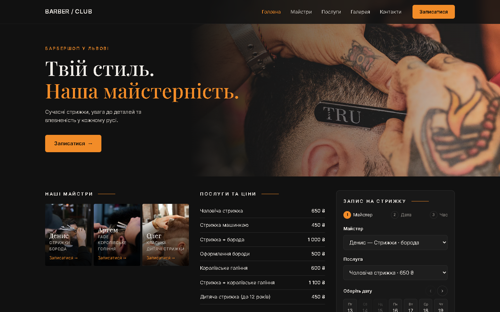

# BARBER / CLUB

Лендінг барбершопу з онлайн-записом до майстра.



## Що є

- Перший екран, майстри, послуги з цінами, галерея робіт з лайтбоксом, контакти з картою
- Запис у три кроки: майстер → дата → час
  - у кожного майстра свої робочі дні
  - вільні слоти рахуються з урахуванням тривалості послуги (стрижка + борода займає 3 слоти підряд)
  - минулий час і вже зайняті вікна недоступні
- Валідація імені та українського номера телефону
- Заявка відправляється в Telegram адміністратору через Netlify Function (`netlify/functions/booking.js`)
- Адаптив від 320 px, мобільне меню, підсвітка активного пункту меню при скролі

Без фреймворків — чистий HTML, CSS і JavaScript.

## Запуск

```bash
npx serve .
```

або будь-який статичний сервер. Без Netlify заявки зберігаються в `localStorage` — зручно для перевірки.

## Деплой на Netlify

1. Підключити репозиторій у Netlify (налаштування збірки не потрібні).
2. Додати змінні оточення `TELEGRAM_TOKEN` і `TELEGRAM_CHAT_ID`.

## Структура

```
index.html
css/style.css
js/data.js        — майстри, послуги, графік роботи
js/booking.js     — розрахунок вільних слотів, збереження записів
js/main.js        — рендер, форма, навігація
netlify/functions/booking.js — пересилання заявки в Telegram
```

Фото — [Unsplash](https://unsplash.com) (вільна ліцензія).
